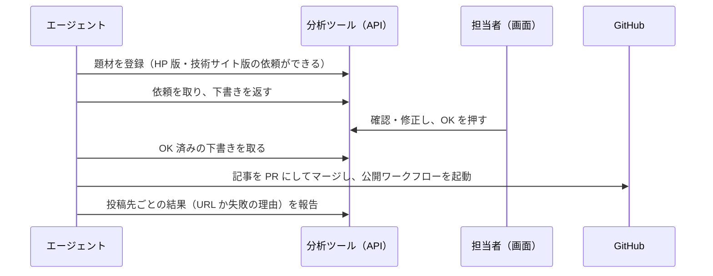

## はじめに

社内のサイト分析ツールに、AI のエージェントが技術記事を執筆し、人は確認・修正・公開の判断だけを行う仕組みを組み込みました。公開先は、自社サイトのナレッジ、Zenn、Qiita の 3 か所です。OK を押した記事だけが、投稿先ごとの手続きで公開されます。

この記事も、この仕組みで AI のエージェントが執筆し、担当者が画面で確認して公開しました。ここでは、データの持ち方と状態の遷移、そして既存の Zenn・Qiita の公開ワークフローに自動化を接続するときに見つかった注意点を記載します。

## 課題

記事の執筆を AI に任せるとき、問題になるのは「公開の判断を誰が持つか」と「公開の手続きをどこまで自動化するか」です。

当社では、Zenn と Qiita の記事を 1 つの共有リポジトリで管理し、GitHub Actions のワークフロー（`publish-zenn.yml`・`publish-qiita.yml`）で公開しています。このワークフローを、人の OK を合図に自動で起動したいと考えました。ところが、既存のワークフローは人が手で実行する前提で作られていて、そのまま自動化すると、意図しない記事まで公開される作りでした（後述）。

## 仕組みの設計

ツールの中では AI を呼び出しません。外で動くエージェントが、ツールの API で依頼を受け取り、下書きを登録し、公開の結果を報告します。ツールは、依頼の待ち行列、下書きの保存、状態の管理を担当します。

データは、題材・下書き・投稿の記録の 3 つに分けました。

| 表 | 持つもの |
|---|---|
| 題材 | 記事のテーマ。元になったサイトの改善案（ないときは空） |
| 下書き | 投稿先（自社サイト版か、Zenn・Qiita 版か）、本文、前の版への参照、公開に失敗した理由 |
| 投稿の記録 | 投稿先（自社サイト・Zenn・Qiita）ごとの状態（待ち・完了・失敗）、公開先の URL、失敗の理由 |

1 つの題材から、自社サイト版と Zenn・Qiita 版の 2 本を作成します。同じ文章を複数のサイトに載せると、検索エンジンで重複として扱われるためです。Zenn と Qiita は本文を共通にし、前付けとフッターだけを変えます。

書き直しを頼むと、エージェントは新しい下書きを作成し、前の版を参照させます。前の版は「置き換え済み」の状態で残り、画面で比較できます。同じ題材・同じ投稿先で終わっていない書き直しの依頼は、データベースの一意索引で 1 件に制限しました。書き直し中は OK も押せません。

画面に出す状態は、新しい列を持たず、下書きと依頼の状態から導出しています。

| 画面の状態 | 導出の条件 |
|---|---|
| 書いています | 待ちか作業中の依頼がある |
| 確認待ち | 最新の下書きが下書きのまま |
| 公開待ち | 最新の下書きが OK 済み |
| 公開済み | すべての投稿先が完了 |

## 既存の公開ワークフローで見つかった注意点

自動化の前に、共有リポジトリのワークフローの定義を確認しました。注意点は 3 つありました。

1 つ目は、公開の範囲です。Zenn のワークフローは、著者のフィールドが一致する記事をすべて個人の Zenn 用リポジトリに同期し、`published: false` を `true` に書き換えます。Qiita のワークフローも、その著者の記事を `qiita publish --all` で一括公開します。つまり、OK 前の記事が main ブランチにあると、別の記事を公開した時点で一緒に公開されます。そこで、記事は OK のあと、公開の直前に PR でマージする順番にしました。

2 つ目は、Qiita の二重投稿です。Qiita のワークフローは、公開後に記事の ID を書き戻す PR を自動で作成します。この PR をマージしないと、次の公開で同じ記事が新規として扱われ、二重に投稿されます。公開の手続きは、この PR のマージまでを含めて完了としました。

3 つ目は、本文の一致の検査です。ワークフローには、Zenn 版と Qiita 版の本文が同じかを確認する工程があり、違うと停止します（`skip_content_check` で省略はできます）。Zenn・Qiita 版を 1 本の下書きにし、本文を共通にしたのはこのためです。

## 確認したこと

| 確認したこと | 結果 |
|---|---|
| 共有リポジトリの記事と、Zenn 側の記事の突き合わせ | どちらも 5 本で一致。OK 前の記事が main に残っていないことを確認 |
| 題材・書き直し・OK・投稿の結果の API のテスト | 13 本を実装より先に作成し、実装前は 13 本とも失敗することを確認してから実装 |
| 本番と同じ Aurora Serverless v2 の Data API の経路でのテスト | bigint の ID を文字列のまま渡していた箇所を 3 か所検出し、修正 |
| クラウドの定期実行からの到達性 | 分析ツールの API には到達した。組織の非公開リポジトリは、GitHub App の導入なしでは読めなかった |

最後の結果から、定期実行はクラウドではなく、担当者の端末の定期タスクで動かす方針にしました。端末が停止している間は動かないため、毎週の執筆ができなかったときは、別の経路から Slack に通知する設計にしています。

## 結果から分かったこと

既存の公開ワークフローは、人が手で実行し、結果を見て判断する前提で作られていました。人の判断を前提にしたワークフローを自動化に接続するときは、ワークフローの定義を読み、「1 回の実行で何が起きるか」の範囲を確認する必要があると私たちは考えています。今回は、記事を main に入れる時期を変えることで、ワークフロー自体には手を入れずに対応できました。

## 向いている場面・向いていない場面

向いているのは、公開先が少なく固定されていて、公開の判断を 1 人か少人数で持てる場面です。投稿先を画面で自由に追加できる形は、今回は作っていません。

向いていないのは、記事の正確さを担当者が確認できない分野です。AI が執筆した内容の事実確認は、担当者の確認に頼っています。

## 限界

毎週の題材の選定と執筆の定期実行は、これから作成します。今回の記事は、この仕組みで最初に公開する試行です。担当者の確認の時間がどれだけ減るかは、まだ測っていません。

## まとめ

AI に執筆を任せ、人は確認と公開の判断だけを持つ仕組みを作りました。既存の公開ワークフローに自動化を接続するときは、1 回の実行で公開される範囲を先に確認することが重要でした。

