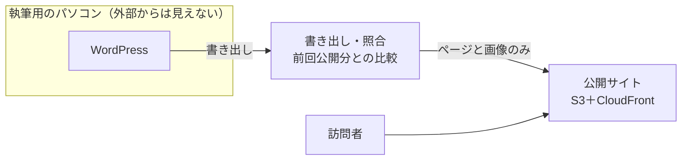

## はじめに

当社は、PHP や WordPress のプラグインに欠陥が見つかっても公開サイトが影響を受けない、ホームページの仕組み「CMS OFFLINE」を準備しています。記事の作成は手元のパソコンで行い、公開サーバーには書き出した静的なページだけを設置する方式で、管理画面もデータも公開サーバーに置きません。WordPress を使い続けたい会社にも、WordPress の利用をやめたい会社にも利用できる設計です。現在は提供開始に向けて準備中で、機能はいずれも提供予定です。

2026年10月21日には、PHP そのものに重大な欠陥（通称 PHP2Shell）が見つかり、国内のレンタルサーバーでも対応が続きました。公開サーバーで PHP が動作している限り、このような欠陥は公開サイトへの攻撃の経路になります。

## CMS OFFLINE とは

CMS OFFLINE は、ホームページを WordPress で更新している会社向けの仕組みです。WordPress の利用をやめたい場合の移行にも利用できます。特徴は次のとおりです。

- WordPress を手元のパソコンで動作させ、書き出した静的なページだけを公開します。見た目とページの URL は現状のままです
- 書き出したページを前回公開分と照合し、ページの消失や見覚えのないコードの追加など、崩れや書き換えの兆しがあれば公開を停止します
- 公開した版を保存し、問題があった場合は前の版へ復元します
- お問い合わせのフォームは受信用の仕組みで受け付けてメールで通知し、サイト内検索は書き出したページの中だけで動作する方式に置き換えます
- 公開サイトの書き換えの有無を、毎日外部から確認します

## しくみ

記事を作成する場所（手元のパソコン）と、公開する場所（公開サーバー）を分けます。公開サーバーに設置するのは、書き出したページと画像だけです。

たとえると、「商品は工房（パソコン）で作り、店頭（公開サイト）にはできあがった商品だけを並べる」形です。工房にはお客さんも泥棒も入れません。

| | 一般的な WordPress の運用 | CMS OFFLINE |
|---|---|---|
| 記事の作成場所 | インターネット上の WordPress | 手元のパソコンの中の WordPress。パソコンの中だけで WordPress を動かすツール（WordPress Studio など）を使用 |
| 公開するもの | WordPress がその場で生成したページ | 書き出したページと画像のみ（静的なファイル） |
| 公開サイトの置き場所 | PHP が動作するサーバー | プログラムが動作しない置き場所。当社は AWS の S3（ファイルの保管庫）と CloudFront（訪問者への配信網）を使用 |
| 管理画面とデータベース | 公開サーバー上 | 手元のパソコンの中 |

WordPress を静的なファイルに書き出して配信する方法自体は、以前からあります。防止できる範囲は、「公開サーバーに何を置かないか」で決まります。この点が表面化したのが、次に記載する 2026年10月の PHP の欠陥です。

## PHP2Shell で何が起きたか

ホームページを動かしている PHP そのものに、外部から乗っ取られうる欠陥が見つかりました。

| 日付 | 出来事 | 出典 |
|---|---|---|
| 2026年10月21日 | PHP 8.5.12・8.4.27・8.3.36・8.2.35 を公開。CVE-2026-109618 と CVE-2026-109619 を修正。どちらも認証なしのリモートコード実行につながりうる重大な欠陥とされた | [PHP 公式のニュース（2026年）](https://www.php.net/archive/2026.php) |
| 2026年10月21日〜22日 | ロリポップ！が予防措置として、サービスサイト・ユーザー専用ページなどを順次停止。22日の未明から昼ごろまで、一部のサーバーでお客様のサイトの表示も停止した | [ロリポップ！のお知らせ（経緯のご報告）](https://lolipop.jp/info/news/8239/) |

修正版の公開前に詳細が出回り（[Recorded Future](https://www.recordedfuture.com/blog/php2shell-vulnerability-exploitation)）、攻撃の試みも報告されています（[Arctic Wolf](https://arcticwolf.com/resources/blog/php2shell-critical-php-vulnerabilities-enable-unauthenticated-remote-code-execution/)）。

## なぜ WordPress のサイトが影響を受けるのか

WordPress は、訪問者がページを開くたびに、サーバー上で PHP を動かしてページを生成しているためです。

WordPress のサイトでは、訪問者がページを開くと、サーバー上で PHP のプログラムが動作し、データベースから記事を読み出してページを組み立てます。公開しているサーバーでは、常に PHP が動作しています。

このため、次のどれかに欠陥や弱点があると、公開サイトが攻撃の経路になります。

- PHP そのもの。今回の PHP2Shell がこれに該当し、WordPress やプラグインを最新にしていても、サーバーの PHP が古ければ影響を受けます
- WordPress のプラグイン。Patchstack の報告では、2025年に見つかった WordPress まわりの欠陥は 11,334 件で、そのうち 91% がプラグイン、9% がテーマ、WordPress 本体は 6 件でした（[Patchstack: State of WordPress Security in 2026](https://patchstack.com/whitepaper/state-of-wordpress-security-in-2026/)）
- インターネットに公開されたログイン画面（管理画面）。パスワードの総当たりは、ログイン画面に誰でもアクセスできるために発生します

## CMS OFFLINE が対象とする問題

CMS OFFLINE が対象とするのは、WordPress のサイトを安全に保つために、PHP・WordPress 本体・プラグインの更新を継続しなければならない状況です。前述のとおり欠陥の多くはプラグインにあり、今回の PHP2Shell のように、利用者側で更新を済ませていても、サーバーの PHP の欠陥で公開サイトが影響を受ける場合もあります。

この更新と監視を外部に委託する方法として、国内には WordPress の保守代行サービスがあります。当社が 2026年10月29日に調査した国内の 6 社では、月額の下限は 980 円から 44,000 円でした。6 社とも、公開サーバー上の WordPress を保護する形のサービスです。

CMS OFFLINE は、公開サーバーから WordPress と PHP を取り除き、攻撃の経路そのものを減らす方式でこの問題に対応します。

## 安全である理由

CMS OFFLINE が安全である理由は、外部から侵入される経路を構成の段階で取り除いている点です。公開サーバーではプログラムが動作しないため、PHP・WordPress・プラグインの欠陥の影響を受けません。ログイン画面も外部に公開しません。

公開先にも対策を講じる設計としています。ファイルの保管庫（S3）は外部への公開を禁止する設定に固定し、訪問者には配信網（CloudFront）を経由してのみ配信します。公開に使う鍵は公開だけができる権限の小さい鍵とし、AWS のアカウントには多要素認証を設定します。

機能の追加は、当社が作成して確認した少数の機能に限定し、誰でも機能を追加できるプラグインの仕組みは設けません。私たちは、検証していない第三者のプログラムが入ることが、WordPress が狙われやすくなった原因だと考えています。

それでも書き換えが起きた場合に備え、公開前の照合、公開後の毎日の監視、前の版への復元によって検知と復旧を行います。

## どこまで防止できるか

前述の構成により、外部から侵入される種類の被害は防止できます。AWS の鍵と執筆用のパソコンは新たな保護対象になるため、表のとおり対策を併用して防止します。

| 被害の種類 | 一般的な WordPress の運用 | CMS OFFLINE |
|---|---|---|
| PHP そのものの欠陥（今回の PHP2Shell） | 公開サイトが攻撃の経路になる | 防止できる。公開サイトに PHP がない |
| プラグイン・テーマの欠陥 | 公開サイトが攻撃の経路になる | 防止できる。プラグインは手元のパソコンの中にあり、外部からアクセスできない |
| ログイン画面へのパスワードの総当たり | ログイン画面に誰でもアクセスできる | 防止できる。ログイン画面が外部にない |
| 同じサーバーの他の利用者が侵入され、巻き添えになる | ありうる（共用サーバーの場合） | 防止できる。公開先を共用サーバーから移行した場合 |
| AWS のアカウントや、公開用の鍵の盗難 | — | 多要素認証と、公開だけができる権限の小さい鍵を併用して防止する |
| 執筆用のパソコンの故障・紛失によるデータの消失 | — | 手元のデータを別の場所にバックアップすることで防止する |
| 執筆用のパソコンがウイルスに感染し、書き出すページに不正なコードが混入する | — | 書き出したページを前回公開分と照合し、見覚えのないコードが増えていたら公開を停止することで、不正なコードの公開を防止する |
| ドメイン（DNS）の乗っ取り | ドメインの管理会社の管理画面で多要素認証を設定することで防止する | 同左 |

表の「防止できる」は、CMS OFFLINE の構成から言えることです。被害がどの程度減るかの数値は、まだ測定していません。

## 導入の利点

導入の利点は次のとおりです。

- 現在の WordPress とテーマを使い続けられます。後述の試行では、見た目に関わるプラグインやテーマは手元でもそのまま使用できました
- 見た目とページの URL が変わらないため、既存のリンクやブックマークをそのまま利用できます
- 公開サイトに PHP がないため、PHP の欠陥が公表されても、公開サイトの PHP を急いで更新する作業は発生しません
- 公開前に変更箇所を画面で確認できるため、意図しない変更が公開される前に気付けます
- 料金は初期費用 110,000 円から、月額は標準プラン 5,500 円（月のページビュー 5 万まで）とアクセス拡張プラン 11,000 円（15 万まで）の予定です（いずれも税込）。目安を超えた分は 1 万ページビューごとに 770 円です。メールは含みません

## WordPress の利用をやめたい場合

CMS OFFLINE は、WordPress の利用をやめたい会社にも、移行の手段として利用できます。公開サイトはどの場合も書き出したページだけなので、記事を作成する道具を後で取り替えても、公開サイトの URL と見た目は変わりません。

移行の進め方は、現在のサイトの WordPress への依存の大きさで決めます。依存の大きさは、テーマで見た目を作っているか、見た目に関わるプラグインがあるか、記事の量、作成者の慣れ、制作会社が作成したサイトかで判断します。

| 依存の大きさ | 進め方 |
|---|---|
| 小さい | 当社がページの型を作成してお渡しし、当社の CMS（記事を作成する道具）へすぐに移行します。本文の文字と画像を書き換えられ、ページを追加できる設計です |
| 大きい | まず手元の WordPress で作成する形で導入し、WordPress をインターネットから切り離します。その後、少しずつ当社の CMS へ移行します。WordPress を切り離した時点で、前述の防止の範囲が適用されます |

ページの型の作成は別にお見積もりします。この移行の形も提供予定です。

## 向いていないサイト

訪問者の操作をサーバーが受け付ける機能が多いサイトには向いていません。

書き出したページは静的なファイルなので、次のような機能はそのままでは動作しません。

- お問い合わせのフォーム
- サイト内検索
- 会員のログイン、ネット販売、予約、コメント

このうちお問い合わせとサイト内検索は、特徴に記載した代替の仕組みで対応します。会員・販売・予約が中心のサイトは、CMS OFFLINE の利点が薄れるため、個別の検討が必要です。

## 試行で判明した点

当社は、ある会社の WordPress のサイト（50 ページ）で、手元のパソコンへの移行と書き出しを試行し、見た目を保ったまま書き出せることを確認しました。公開中のサイトには書き込まず、バックアップから手元に再現しています。手元への移行には、いくつかの課題もありました。

- 「必ず https にする」プラグインは、手元では停止が必要でした。停止しないと、手元の WordPress が開けませんでした
- UpdraftPlus（WordPress のバックアップ用プラグイン）で取得したバックアップは、WordPress Studio が読み込める形式に再構成する必要がありました。日本語のファイル名の画像は、再構成の際に文字コードを指定しないと文字化けしました
- 見た目に関わるプラグインやテーマは、手元でもそのまま使用できました。訪問者の操作を受け付けるもの（フォーム・検索・コメント）は、前述のとおり書き出した後は動作しません
- 書き出した 50 ページをスマートフォンと PC の幅で公開中のサイトと比較し、見た目が同じであることを確認しました

## まとめ

CMS OFFLINE は、記事の作成を手元のパソコンで行い、書き出したページだけを公開することで、PHP やプラグインの欠陥による外部からの侵入を構成上防止します。AWS の鍵、執筆用のパソコン、ドメインの管理は新たな保護対象になり、多要素認証やバックアップなどの対策を併用して防止します。WordPress を使い続ける場合にも、WordPress の利用をやめたい場合にも利用できます。

https://pr-i.co.jp/products/cms-offline/?utm_source=article&utm_medium=zenn_qiita&utm_campaign=php2shell
